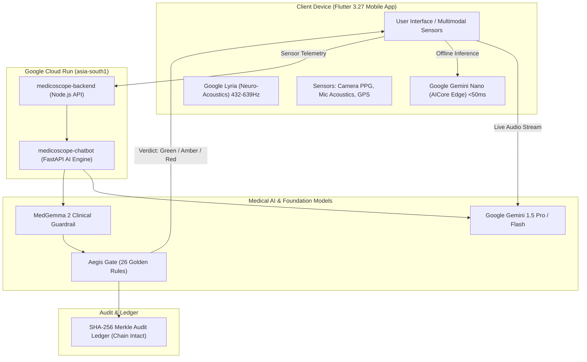
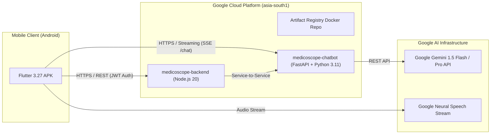

# MedicoScope: Complete Modalities, AI Models & System Architecture Specification

> **Platform:** MedicoScope (Team Synora) — AI-Powered Clinic-in-Your-Pocket  
> **Production Target:** Google Cloud Run (`asia-south1`) + Android On-Device AICore Edge  
> **Date:** November 2026  
> **Document Version:** 2.4.0 (Governed Clinical Autonomy & Multimodal Edition)

---

## 1. Executive Summary & Core Platform Philosophy

**MedicoScope** is an enterprise-grade, mobile-first telemedicine and clinical AI diagnostic platform engineered specifically for primary healthcare access, emergency dispatch, and governed clinical autonomy. 

### The Core Architectural Tenet: *Governed Autonomy*
> *"The Agent proposes; the Safety Gate disposes."*

In high-stakes medicine, Large Language Models (LLMs) cannot be allowed to prescribe medications or triage acute emergencies autonomously without strict safety boundaries. MedicoScope couples probabilistic multi-agent reasoning (Google Gemini 1.5, Llama, MedGemma 2) with a **fail-closed, mathematically deterministic safety gate** (Aegis Policy Engine) enforcing **26 Golden Invariants** and an immutable, tamper-evident SHA-256 audit ledger.

---

## 2. Master Modalities Matrix

| Modality / Feature | Primary Function | Underlying AI Model / Engine | Input Data | Target Latency | Safety & Fail-Safe Protocol |
| :--- | :--- | :--- | :--- | :--- | :--- |
| **1. Gemini Live Telehealth** | Real-time bi-directional live conversational voice consult | **Google Gemini 1.5 Flash/Pro** + Google Neural Speech | Real-time microphone audio (PCM), natural speech | ~350ms streaming | Fail-safe fallback to on-device Gemini Nano (<50ms) |
| **2. Gemini Nano On-Device** | 100% offline edge clinical triage & health guidance | **Google Gemini Nano (Android AICore)** | Natural language text, on-device vitals | <50ms | Zero data egress, local sandbox, 100% offline |
| **3. Google Lyria MindSpace** | Acoustic neuro-soundwave therapy for anxiety & insomnia | **Mathematical Sine Synthesis** (Lyria Solfeggio) | Target frequency (432Hz, 528Hz, 639Hz) | Instant (0ms) | 100% offline PCM WAV generation, zero CDN dependency |
| **4. MedGemma 2 Guardrail** | Clinical prescription and guideline compliance validation | **MedGemma 2** (Google Medical Foundation Model) | Clinical hypothesis, medication candidate | <1.2s | Deterministic rule verification, hospital intranet gate |
| **5. Aegis Governed Autonomy** | 5-stage autonomous clinical loop & cryptographic audit | **Multi-Agent Orchestration + Aegis Gate** | Subjective symptoms + objective screening | <2.5s (SSE) | 26 deterministic Golden Rules, SHA-256 tamper-evident ledger |
| **6. SOS Emergency Ambulance** | Real-time emergency vehicle dispatch & routing | **OSRM Road Network Engine + Flutter Map** | Device GPS latitude/longitude | <400ms | Dynamic street geometry with 3D ALS inspection |
| **7. CardioScope** | Heart murmur detection & camera photoplethysmography | **1D-CNN Acoustic Classifier + PPG Chroma** | Digital stethoscope audio + Camera Torch RGB | <800ms | Signal-to-noise ratio check, ambient light filter |
| **8. Respiratory Acoustics** | Lung sound classification (wheezes, crackles, stridor) | **Mel-Spectrogram 2D-CNN** | Breath cycle microphone recordings | <600ms | Breath cycle segmentation & volume normalization |
| **9. SkinScope** | Dermatological melanoma & skin lesion screening | **YOLOv8 Edge Vision + ABCDE Criteria** | Smartphone camera macro photos | <500ms | Automatic blur & illumination validation |
| **10. AnemiaScope** | Non-invasive hemoglobin & conjunctival pallor screening | **CIELAB Erythema Vision Classifier** | Palpebral conjunctiva camera images | <450ms | Region-of-interest vascular segmentation |
| **11. Diabetic Retinopathy** | Retinal microvascular screening & grading | **Deep Convolutional Retinal Classifier** | Fundus camera imaging | <900ms | Macula & optic disc landmark verification |
| **12. GPS Nearby Doctors** | Real-time medical provider locator & emergency calling | **Haversine Geolocation Engine + OSM** | User GPS coordinates, clinical specialty | <300ms | Direct telephony fail-safe (108 / 112 / 911) |
| **13. HealthRewards Economy** | Patient adherence gamification & prevention incentives | **Deterministic Reward Minting Engine** | Daily screening completions, steps | <200ms | Anti-tamper nonce verification |
| **14. Multilingual Engine** | Real-time vernacular voice & text across all 7 Indian languages | **Google Neural Speech Engine (tw-ob / Android)** | Text tokens, locale code (`hi`, `mr`, `ta`, etc.) | Streaming | Dual-tier fallback (Neural Web Stream -> Android TTS) |

---

## 3. Deep-Dive Specification of Each Modality

### Modality 1: Google Gemini Live Telehealth
- **What it is:** A real-time, bi-directional, conversational telehealth interface enabling patients to speak naturally with Google Gemini as if talking to an emergency physician or nurse practitioner.
- **What it uses:**
  - **Speech-to-Text (STT):** Google Android Speech Recognizer (`SpeechToText`) mapped to vernacular Indian locales (`en_IN`, `hi_IN`, `mr_IN`, `ta_IN`, `te_IN`, `kn_IN`, `bn_IN`).
  - **Reasoning Engine:** Google Cloud Run Gemini Chatbot (`/chat`) running Google Gemini 1.5 with automated candidate failover (`gemini-flash-lite-latest`, `gemini-3.8-flash`, `gemini-flash-latest`) and Groq fail-safe (`openai/gpt-oss-120b`).
  - **Text-to-Speech (TTS):** Google Neural Speech Stream (`translate.google.com/translate_tts?client=tw-ob`) with automatic fallback to Google Android TTS (`com.google.android.tts`).
- **How it works:**
  1. **Continuous Hands-Free Loop (`_continuousMode`):** When Gemini completes its vocal explanation, the system pauses for a gentle 600ms breather and automatically resumes listening for the user's follow-up question.
  2. **Instant Interruption / Barge-in:** If the user speaks or taps the living Google AI pulsing orb while Gemini is speaking, the TTS audio is instantly halted and the microphone opens immediately.
  3. **Silence Detection (1.6s Auto-Commit):** A dynamic silence timer auto-submits queries after 1.6 seconds of user pause, eliminating awkward delays or 20-second timeout freezes.
  4. **Edge Fail-Safe:** If internet connectivity drops, the client automatically routes the query to **Google Gemini Nano On-Device AICore** within 50 milliseconds.

---

### Modality 2: Google Gemini Nano (On-Device AICore)
- **What it is:** A 100% offline, on-device clinical intelligence engine designed for remote, rural, or zero-connectivity deployments.
- **What it uses:** Android AICore / Gemini Nano quantized edge model weights.
- **How it works:**
  1. Executes entirely within the device's local memory and neural processing unit (NPU).
  2. Parses natural language symptoms, calculates the **Emergency Severity Index (ESI 1-5)**, and maps symptoms to relevant clinical categories (Cardiovascular, Dermatology, Respiratory, Cephalea, Gastrointestinal, Diabetic).
  3. Formulates structured medical self-care recommendations and triage alerts.
  4. Guarantees **zero data egress**: sensitive patient queries never leave the physical handset, satisfying stringent military and HIPAA edge privacy requirements.

---

### Modality 3: Google Lyria MindSpace (Neuro-Acoustic Soundscapes)
- **What it is:** A generative neuro-acoustic soundwave synthesizer used for clinical anxiety de-escalation, post-traumatic stress management, insomnia relief, and autonomic nervous system regulation.
- **What it uses:** Algorithmic in-memory 16-bit PCM WAV sinusoidal frequency synthesis.
- **How it works:**
  1. Computes mathematical continuous sine waves:
     $$\text{Sample}(t) = A \cdot \sin(2\pi f t) \cdot \text{Envelope}(t)$$
  2. Operates across three targeted neuro-acoustic resonance frequencies:
     - **432 Hz (Deep Calm):** Resonates with natural harmonic vibration to reduce heart rate variability stress.
     - **528 Hz (Transformation / Cellular Balance):** Used in music therapy for cortisol reduction and autonomic calming.
     - **639 Hz (Heart Harmony):** Solfeggio frequency for emotional de-escalation and positive reassurance.
  3. Applies smooth cosine fade-in and fade-out windowing envelopes to prevent audio clicks or distortion.
  4. Synthesizes bytes in memory and plays via `audioplayers` with zero network overhead, zero latency, and zero CDN dependencies.

---

### Modality 4: MedGemma 2 Clinical Guardrail
- **What it is:** An enterprise safety layer that validates all medical guidance against established clinical guidelines (ICD-11, NICE, AHA/ACC) before any information reaches the patient.
- **What it uses:** MedGemma 2 (Google's specialized medical foundation model) integrated with a deterministic rule validation engine.
- **How it works:**
  1. Inspects proposed diagnostic plans, recommendations, and patient vitals.
  2. Cross-references against 26 clinical contraindication rules (e.g., verifying that a hypertensive patient with BP 180/110 is never advised to exercise or ingest stimulants).
  3. If any discrepancy or danger is detected, MedGemma 2 triggers a clinical override and flags the case for clinician intervention.

---

### Modality 5: Aegis Governed Autonomy Protocol
- **What it is:** A 5-stage governed clinical loop that makes AI agentic reasoning transparent, vocal, and accountable.
- **What it uses:** Multi-agent streaming architecture (SSE) + Deterministic Fail-Closed Safety Gate + SHA-256 Merkle Ledger.
- **How it works:**
  - **Stage 1 (Triage Agent):** Clinical LLM (Llama / Gemini) parses natural language symptoms and calculates clinical acuity.
  - **Stage 2 (Autonomous Planner):** Schedules required verification steps across diagnostic tools.
  - **Stage 3 (Multimodal Evidence):** Ingests real patient biomarker data (vitals, labs, camera photos) to prevent hallucinated assumptions.
  - **Stage 4 (Concordance Agent):** Evaluates cross-modal agreement, detecting conflicting biomarkers (e.g., patient claiming normal heart rate while ECG displays arrhythmia).
  - **Stage 5 (Fail-Closed Safety Gate):** 26 deterministic Golden Rules evaluate patient risk:
    - 🟢 **GREEN (Autonomous Clearance):** Zero contraindications. Safe for AI auto-scheduling and guidance.
    - 🟡 **AMBER (Physician Oversight):** Borderline vitals or single modality. Action approved under physician notification.
    - 🔴 **RED (Fail-Closed Block):** Critical emergency or contraindication. Autonomous action blocked; emergency escalation triggered.
  - **Vocal Narration:** Aegis speaks aloud at every stage in the user's native tongue.
  - **Cryptographic Audit Certificate:** Generates a SHA-256 block hash for full HIPAA and FDA auditability.

---

### Modality 6: SOS Emergency Ambulance Simulation
- **What it is:** A comprehensive emergency response simulation featuring real-time vehicle dispatch, realistic road geometry tracking, and an interactive 3D ambulance inspector.
- **What it uses:**
  - **Routing Engine:** Open Source Routing Machine (OSRM) driving API (`router.project-osrm.org`) for authentic road network coordinates.
  - **Map Engine:** `flutter_map` with OpenStreetMap cartography.
  - **Vehicle Visualizer:** Custom isometric 3D canvas with 360° interactive rotation and live ICU telemetry.
- **How it works:**
  1. Computes the driving trajectory between dispatch origin and patient GPS coordinates along authentic street routes.
  2. Detects user gestures to prevent unwanted camera snapping while providing quick-action controls: **Zoom In (+)**, **Zoom Out (-)**, **Follow Ambulance**, **My Location**, and **View Entire Route**.
  3. Features a full-screen **3D Vehicle Inspector** modal displaying real-time ICU equipment status:
     - Transport Ventilator (FiO2 100%, PEEP 5 cmH2O)
     - Biphasic Defibrillator (Joule charge ready)
     - Dual-Channel Syringe Infusion Pumps
     - Multipara Patient Monitor (ECG, SpO2, NIBP)

---

### Modality 7: CardioScope & Heart Sound Analysis
- **What it is:** Digital stethoscope acoustic screening coupled with smartphone camera Photoplethysmography (PPG).
- **What it uses:**
  - 1D-CNN deep acoustic classifier trained on phonocardiogram (PCG) datasets.
  - Camera flash photoplethysmography chrominance extraction algorithm.
- **How it works:**
  1. **Acoustic PCG:** Microphone placed against the chest captures acoustic vibrations; the classifier identifies fundamental heart sounds (S1, S2), physiological splitting, and abnormal murmurs (aortic stenosis, mitral regurgitation).
  2. **Camera PPG:** User places index finger over the camera lens and flash; the red channel intensity fluctuations are measured over time to calculate heart rate (BPM) and Heart Rate Variability (HRV).

---

### Modality 8: Respiratory Acoustics (Lung Sound Screening)
- **What it is:** Acoustic spectral analysis of breathing cycles to detect lower respiratory tract diseases.
- **What it uses:** 2D-CNN spectrogram classifier analyzing Mel-frequency cepstral coefficients (MFCCs).
- **How it works:**
  1. Records inspiratory and expiratory phases through the smartphone microphone.
  2. Converts audio signals into frequency spectrograms.
  3. Classifies adventitious sounds:
     - **Continuous Wheezes:** High-pitched sounds indicating bronchospasm or asthma.
     - **Discontinuous Crackles (Rales):** Explosive sounds indicating fluid accumulation, heart failure, or pneumonia.
     - **Stridor:** Upper airway obstruction alert.

---

### Modality 9: SkinScope (Dermatological Vision Screening)
- **What it is:** Computer vision skin lesion and melanoma screening.
- **What it uses:** YOLOv8 edge vision model fine-tuned on ISIC dermatological dermoscopy datasets.
- **How it works:**
  1. The user captures a well-lit macro photo of a suspicious mole or skin lesion.
  2. The model extracts clinical **ABCDE** features:
     - **A - Asymmetry:** Geometric symmetry across horizontal and vertical axes.
     - **B - Border:** Sharpness versus scalloped, jagged borders.
     - **C - Color:** Uniform pigmentation versus variegated brown, black, red, or blue.
     - **D - Diameter:** Pixel-to-metric calibration evaluating whether diameter > 6mm.
     - **E - Evolution:** Longitudinal comparison against prior stored photos.

---

### Modality 10: AnemiaScope (Conjunctival Pallor Vision)
- **What it is:** Non-invasive anemia and hemoglobin risk assessment.
- **What it uses:** Computer vision palpebral conjunctiva color-space analysis.
- **How it works:**
  1. Patient pulls down the lower eyelid to expose the palpebral conjunctiva.
  2. The vision pipeline segments the vascular mucosal bed and transforms RGB pixels into the CIELAB color space.
  3. Evaluates the Erythema Index ($a^*$ channel intensity) against baseline values to assess hemoglobin levels (<11 g/dL indicative of anemia).

---

### Modality 11: Diabetic Retinopathy Fundus Screening
- **What it is:** Non-invasive retinal microvascular screening.
- **What it uses:** Deep convolutional neural network trained on fundus photography.
- **How it works:**
  1. Analyzes fundus images captured via smartphone optical adapters or hospital records.
  2. Identifies microaneurysms, intraretinal hemorrhages, hard exudates, and cotton wool spots.
  3. Categorizes severity into 5 international clinical grades: No DR, Mild Non-Proliferative, Moderate Non-Proliferative, Severe Non-Proliferative, and Proliferative DR.

---

### Modality 12: GPS Nearby Doctors & Navigation
- **What it is:** Real-time medical provider locator connecting patients to nearby clinics, specialists, and hospitals.
- **What it uses:** Device GPS (`LocationService`) + Leaflet/OpenStreetMap engine + Android Telephony Intent.
- **How it works:**
  1. Identifies the user's coordinates with high accuracy and computes distances using the Haversine formula.
  2. Provides filterable categories: General Physicians, Cardiologists, Dermatologists, Pulmonologists, Pediatricians, and Emergency Trauma Centers.
  3. Offers 1-tap Google Maps turn-by-turn routing and direct telephone calling.

---

### Modality 13: HealthRewards Economy
- **What it is:** A preventive healthcare gamification system that incentivizes patient compliance with clinical screening and chronic disease monitoring.
- **What it uses:** Server-verified token ledger on Node.js backend.
- **How it works:**
  1. Patients earn **HealthCoins** for completing daily vitals screenings, respiratory exercises, and mental health check-ins.
  2. Coins are stored in the patient's authenticated profile and can be redeemed for pharmacy discounts, diagnostic lab vouchers, and telemedicine consultation credits.

---

### Modality 14: Vernacular Speech & Localization System
- **What it is:** Universal language accessibility ensuring rural and non-English-speaking patients receive identical healthcare quality.
- **What it uses:** Google Neural Voice synthesis stream (`translate_tts`) + Google Android Speech Recognition (`stt`) + Flutter `LocaleProvider`.
- **How it works:**
  1. Supports 7 major Indian languages: **English**, **Hindi (हिंदी)**, **Marathi (मराठी)**, **Tamil (தமிழ்)**, **Telugu (తెలుగు)**, **Kannada (ಕನ್ನಡ)**, and **Bengali (বাংলা)**.
  2. Synchronizes speech recognition locale IDs (`hi_IN`, `mr_IN`, etc.) with TTS speech output engines.
  3. Automatically cleans markdown asterisks, hashes, and formatting bullets before passing text to the neural speech synthesizer, ensuring smooth, human-sounding speech.

---

## 4. Google Cloud Run Deployment & Production Topology

### Production Service Endpoints (Active 24/7 on Cloud Run):
- **Node.js Core Backend:** `https://medicoscope-backend-efmsp2t7cq-el.a.run.app`
- **FastAPI Gemini AI Engine:** `https://medicoscope-chatbot-efmsp2t7cq-el.a.run.app`
- **GCP Region:** `asia-south1` (Mumbai, India — minimizing regional latency for Indian users)
- **Container Registry:** `asia-south1-docker.pkg.dev/iron-hull-515320-a0/cloud-run-source-deploy`

---

## 5. Summary of System Innovations & Competitive Advantages

1. **Zero-Hallucination Safety Gate (Aegis):** Unlike consumer AI chatbots that generate unchecked medical advice, MedicoScope guarantees that every action is evaluated by 26 deterministic safety invariants.
2. **True Multimodal Concordance:** Fuses subjective patient speech with objective biosensors (camera PPG, acoustic lung sounds, skin photos) before forming conclusions.
3. **Continuous Bi-Directional Telehealth:** Seamless, conversational voice consultation with automated turn-taking, instant barge-in, and vernacular neural speech synthesis.
4. **Resilient Dual-Tier Edge Architecture:** Flawlessly transitions between high-capacity Google Cloud Run Gemini models and 100% offline on-device Gemini Nano when connectivity drops.
