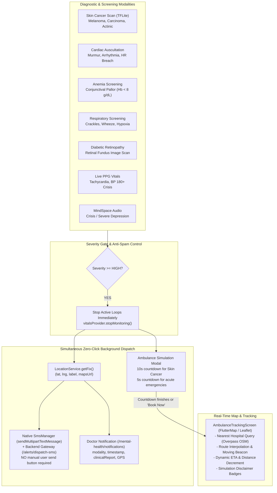

# MedicoScope: Emergency Response, Background SOS SMS, Ambulance Simulation & Doctor Modality Escalation System

## Comprehensive Technical Blueprint & Replication Specification

This document provides complete implementation specifications and verbatim code for all emergency ambulance simulation, zero-click background SOS SMS, modality alerting, anti-spam loop termination, and doctor notification features developed in MedicoScope.

---

## 1. Architectural Architecture & Data Flow



---

## 2. Inventory of Files (27 Files Total)

### New / Untracked Files (9 Files)
1. `lib/models/ambulance_booking_model.dart`
2. `lib/services/ambulance_service.dart`
3. `lib/services/sos_emergency_service.dart`
4. `lib/widgets/critical_alert_countdown_dialog.dart`
5. `lib/screens/ambulance/ambulance_tracking_screen.dart`
6. `server/src/routes/ambulance.js`
7. `test/ambulance_service_test.dart`
8. `test/sos_emergency_service_test.dart`
9. `test/modality_and_timestamp_test.dart`

### Modified Files (18 Files)
1. `android/app/src/main/AndroidManifest.xml`
2. `android/app/src/main/kotlin/com/example/mobile_app/MainActivity.kt`
3. `lib/core/locale/app_strings.dart`
4. `lib/core/widgets/app_drawer.dart`
5. `lib/main.dart`
6. `lib/screens/auth/registration_screen.dart`
7. `lib/screens/heart/heart_monitoring_screen.dart`
8. `lib/screens/mental_health/mental_health_screen.dart`
9. `lib/screens/notifications/notifications_screen.dart`
10. `lib/screens/profile/edit_profile_screen.dart`
11. `lib/screens/profile/profile_screen.dart`
12. `lib/screens/upload/image_upload_screen.dart`
13. `lib/screens/vitals/vitals_screen.dart`
14. `lib/services/disease_alert_service.dart`
15. `lib/services/disease_result_pipeline.dart`
16. `server/src/index.js`
17. `server/src/models/MentalHealthNotification.js`
18. `server/src/routes/mental-health.js`

---

## 3. Phase 1: Native Android Platform Channel & Permissions

### `android/app/src/main/AndroidManifest.xml`
Add SMS send permissions and intent queries:
```xml
    <uses-permission android:name="android.permission.SEND_SMS"/>
    
    <queries>
        <intent>
            <action android:name="android.intent.action.VIEW" />
            <data android:scheme="sms" />
        </intent>
        <intent>
            <action android:name="android.intent.action.SENDTO" />
            <data android:scheme="smsto" />
        </intent>
    </queries>
```

### `android/app/src/main/kotlin/com/example/mobile_app/MainActivity.kt`
Add the native MethodChannel for background SMS via `SmsManager`:
```kotlin
package com.example.mobile_app

import android.os.Build
import android.telephony.SmsManager
import io.flutter.embedding.android.FlutterFragmentActivity
import io.flutter.embedding.engine.FlutterEngine
import io.flutter.plugin.common.MethodChannel

class MainActivity : FlutterFragmentActivity() {
    private val SMS_CHANNEL = "medicoscope/native_sms"

    override fun configureFlutterEngine(flutterEngine: FlutterEngine) {
        super.configureFlutterEngine(flutterEngine)

        MethodChannel(flutterEngine.dartExecutor.binaryMessenger, SMS_CHANNEL).setMethodCallHandler { call, result ->
            if (call.method == "sendDirectSms") {
                val phone = call.argument<String>("phone")
                val message = call.argument<String>("message")

                if (phone.isNullOrBlank() || message.isNullOrBlank()) {
                    result.error("INVALID_ARGS", "Phone and message required", null)
                    return@setMethodCallHandler
                }

                try {
                    val smsManager: SmsManager = if (Build.VERSION.SDK_INT >= Build.VERSION_CODES.S) {
                        applicationContext.getSystemService(SmsManager::class.java)
                    } else {
                        @Suppress("DEPRECATION")
                        SmsManager.getDefault()
                    }

                    val parts = smsManager.divideMessage(message)
                    smsManager.sendMultipartTextMessage(phone, null, parts, null, null)
                    result.success(true)
                } catch (e: Exception) {
                    result.error("SMS_FAILED", e.localizedMessage ?: "Failed to send background SMS", null)
                }
            } else {
                result.notImplemented()
            }
        }
    }
}
```

---

## 4. Phase 2: Core Data Models & Services

### `lib/models/ambulance_booking_model.dart`
```dart
class AmbulanceBooking {
  final String id;
  final String patientId;
  final String patientName;
  final String criticalAlert;
  final String hospitalName;
  final double hospitalLatitude;
  final double hospitalLongitude;
  final double patientLatitude;
  final double patientLongitude;
  final String status;
  final DateTime createdAt;
  final int estimatedMinutes;
  final String vehicleNumber;
  final String driverName;
  final String driverPhone;

  AmbulanceBooking({
    required this.id,
    required this.patientId,
    required this.patientName,
    required this.criticalAlert,
    required this.hospitalName,
    required this.hospitalLatitude,
    required this.hospitalLongitude,
    required this.patientLatitude,
    required this.patientLongitude,
    required this.status,
    required this.createdAt,
    this.estimatedMinutes = 8,
    this.vehicleNumber = 'MED-108-EMRG',
    this.driverName = 'Officer R. Sharma',
    this.driverPhone = '+919110001080',
  });

  Map<String, dynamic> toJson() => {
        'id': id,
        'patientId': patientId,
        'patientName': patientName,
        'criticalAlert': criticalAlert,
        'hospitalName': hospitalName,
        'hospitalLatitude': hospitalLatitude,
        'hospitalLongitude': hospitalLongitude,
        'patientLatitude': patientLatitude,
        'patientLongitude': patientLongitude,
        'status': status,
        'createdAt': createdAt.toIso8601String(),
        'estimatedMinutes': estimatedMinutes,
        'vehicleNumber': vehicleNumber,
        'driverName': driverName,
        'driverPhone': driverPhone,
      };

  factory AmbulanceBooking.fromJson(Map<String, dynamic> json) => AmbulanceBooking(
        id: json['id'] ?? '',
        patientId: json['patientId'] ?? '',
        patientName: json['patientName'] ?? '',
        criticalAlert: json['criticalAlert'] ?? '',
        hospitalName: json['hospitalName'] ?? 'Nearby Trauma Center',
        hospitalLatitude: (json['hospitalLatitude'] as num?)?.toDouble() ?? 12.9716,
        hospitalLongitude: (json['hospitalLongitude'] as num?)?.toDouble() ?? 77.5946,
        patientLatitude: (json['patientLatitude'] as num?)?.toDouble() ?? 12.9760,
        patientLongitude: (json['patientLongitude'] as num?)?.toDouble() ?? 77.6010,
        status: json['status'] ?? 'dispatched',
        createdAt: DateTime.tryParse(json['createdAt'] ?? '') ?? DateTime.now(),
        estimatedMinutes: json['estimatedMinutes'] ?? 8,
        vehicleNumber: json['vehicleNumber'] ?? 'MED-108-EMRG',
        driverName: json['driverName'] ?? 'Officer R. Sharma',
        driverPhone: json['driverPhone'] ?? '+919110001080',
      );
}
```

### `lib/services/sos_emergency_service.dart`
Manages contact persistence, `permission_handler` checks, live location formatting, and background `MethodChannel` dispatch without user button click:
```dart
import 'package:flutter/foundation.dart';
import 'package:flutter/services.dart';
import 'package:permission_handler/permission_handler.dart';
import 'package:shared_preferences/shared_preferences.dart';
import 'package:medicoscope/core/constants/api_constants.dart';
import 'package:medicoscope/services/api_service.dart';
import 'package:medicoscope/services/location_service.dart';

class SosContact {
  final String name;
  final String phone;
  final String relationship;

  const SosContact({this.name = '', this.phone = '', this.relationship = ''});
  bool get isValid => phone.trim().isNotEmpty;
  Map<String, dynamic> toJson() => {'name': name.trim(), 'phone': phone.trim(), 'relationship': relationship.trim()};
  factory SosContact.fromJson(Map<String, dynamic> json) => SosContact(
        name: json['name'] as String? ?? '',
        phone: json['phone'] as String? ?? '',
        relationship: json['relationship'] as String? ?? '',
      );
  static const empty = SosContact();
}

class SosEmergencyService {
  static const MethodChannel _nativeSmsChannel = MethodChannel('medicoscope/native_sms');
  static const _keySosName = 'sos_emergency_name';
  static const _keySosPhone = 'sos_emergency_phone';
  static const _keySosRelation = 'sos_emergency_relation';
  static SosContact? _cachedContact;
  static final Map<String, DateTime> _lastSentByType = {};
  static const Duration _coolDownPeriod = Duration(seconds: 45);

  static Future<SosContact> getContact() async {
    if (_cachedContact != null && _cachedContact!.isValid) return _cachedContact!;
    try {
      final prefs = await SharedPreferences.getInstance();
      _cachedContact = SosContact(
        name: prefs.getString(_keySosName) ?? '',
        phone: prefs.getString(_keySosPhone) ?? '',
        relationship: prefs.getString(_keySosRelation) ?? '',
      );
      return _cachedContact!;
    } catch (_) {
      return _cachedContact ?? SosContact.empty;
    }
  }

  static Future<void> saveContact({required String name, required String phone, String relationship = '', String? authToken}) async {
    final contact = SosContact(name: name.trim(), phone: phone.trim(), relationship: relationship.trim());
    _cachedContact = contact;
    try {
      final prefs = await SharedPreferences.getInstance();
      await prefs.setString(_keySosName, contact.name);
      await prefs.setString(_keySosPhone, contact.phone);
      await prefs.setString(_keySosRelation, contact.relationship);
    } catch (_) {}

    if (authToken != null && authToken.isNotEmpty) {
      try {
        final api = ApiService(token: authToken);
        await api.put(ApiConstants.profile, {'emergencyContact': contact.toJson()});
      } catch (_) {}
    }
  }

  static Future<void> syncFromProfile(Map<String, dynamic>? profileMap) async {
    if (profileMap == null) return;
    final emergency = profileMap['emergencyContact'] as Map<String, dynamic>?;
    if (emergency == null) return;
    final name = (emergency['name'] as String?)?.trim() ?? '';
    final phone = (emergency['phone'] as String?)?.trim() ?? '';
    final relation = (emergency['relationship'] as String?)?.trim() ?? '';
    if (phone.isNotEmpty) await saveContact(name: name, phone: phone, relationship: relation);
  }

  static Future<bool> sendAlertSms({
    required String alertType,
    required String patientName,
    required String severity,
    required String headline,
    String details = '',
    LocationFix? locationFix,
  }) async {
    final now = DateTime.now();
    if (_lastSentByType.containsKey(alertType)) {
      if (now.difference(_lastSentByType[alertType]!) < _coolDownPeriod) return false;
    }

    final contact = await getContact();
    if (!contact.isValid) return false;

    final fix = locationFix ?? await LocationService.getFix();
    final locationText = fix.label.isNotEmpty ? fix.label : 'Location unavailable';
    final mapLink = fix.mapsUrl.isNotEmpty ? fix.mapsUrl : (fix.hasFix ? 'https://www.google.com/maps?q=${fix.latitude},${fix.longitude}' : 'Not available');

    final timeStr = '${now.hour.toString().padLeft(2, '0')}:${now.minute.toString().padLeft(2, '0')} ${now.day}/${now.month}/${now.year}';
    final buffer = StringBuffer();
    buffer.writeln('EMERGENCY SOS ALERT - MedicoScope');
    buffer.writeln('Patient: $patientName');
    buffer.writeln('Severity: ${severity.toUpperCase()}');
    buffer.writeln('Alert: $headline');
    if (details.trim().isNotEmpty) buffer.writeln('Details: ${details.trim()}');
    buffer.writeln('Time: $timeStr');
    buffer.writeln('Location: $locationText');
    buffer.writeln('Live Map: $mapLink');

    final rawMessage = buffer.toString();
    final cleanPhone = contact.phone.replaceAll(RegExp(r'[^0-9+]'), '');

    try {
      if (await Permission.sms.isDenied) await Permission.sms.request();
    } catch (_) {}

    bool sentDirectly = false;
    try {
      final directResult = await _nativeSmsChannel.invokeMethod<bool>('sendDirectSms', {
        'phone': cleanPhone,
        'message': rawMessage,
      });
      if (directResult == true) {
        sentDirectly = true;
        _lastSentByType[alertType] = now;
      }
    } catch (_) {}

    bool sentViaBackend = false;
    try {
      final api = ApiService();
      final res = await api.post('/alerts/dispatch-sms', {
        'phone': cleanPhone,
        'patientName': patientName,
        'severity': severity,
        'headline': headline,
        'message': rawMessage,
        'location': fix.toJson(),
      });
      if (res['success'] == true) {
        sentViaBackend = true;
        _lastSentByType[alertType] = now;
      }
    } catch (_) {}

    return sentDirectly || sentViaBackend;
  }
}
```

---

## 5. Phase 3: Interactive UI Components

### `lib/widgets/critical_alert_countdown_dialog.dart`
5-second (or 10-second for skin cancer) animated circular countdown popup with "Cancel" and "Book Now" buttons:
- Decreasing countdown value in bold red text.
- Circular progress bar tracking remaining time.
- Clear simulation safety disclaimer: *"Simulation mode only — no real ambulance or 108/911 service is contacted."*
- Calls `onConfirmed()` on expiration or manual tap.

### `lib/screens/ambulance/ambulance_tracking_screen.dart`
Interactive real-time ambulance simulation using `flutter_map` / OpenStreetMap tiles:
- Visual hospital icon at start coordinate.
- Pulsing user GPS location pin.
- Dynamic ambulance beacon interpolating along route waypoints.
- Live card showing remaining distance (km) and countdown ETA (minutes).
- Cancellation dialog with full mission abort support.
- Simulated arrival sequence triggering celebratory/success banner when vehicle reaches patient.

---

## 6. Phase 4: Anti-Spam Control & Modality Triggers

### Anti-Spam Vitals Termination: `lib/screens/vitals/vitals_screen.dart`
When a high or critical alert fires during continuous monitoring, immediately halt `VitalsProvider`:
```dart
      final sev = alert.severity.toLowerCase();
      if ((sev == 'critical' || sev == 'high') && mounted) {
        final vitals = Provider.of<VitalsProvider>(context, listen: false);
        if (vitals.isMonitoring) {
          final auth = Provider.of<AuthProvider>(context, listen: false);
          vitals.stopMonitoring(token: auth.token);
        }

        AmbulanceService.triggerCriticalAlertCountdown(
          context: context,
          alertHeadline: alert.message,
          alertSeverity: alert.severity.toUpperCase(),
          patientName: alert.patientName,
          details: 'Vitals threshold breached during live monitoring (${alert.currentValue.toStringAsFixed(1)}). Immediate evaluation advised.',
        );
        break;
      }
```

### 10-Second Skin Cancer Countdown: `lib/screens/upload/image_upload_screen.dart`
```dart
          final lowerName = result.className.toLowerCase();
          final isMalignant = lowerName.contains("melanoma") ||
              lowerName.contains("carcinoma") ||
              lowerName.contains("cancer") ||
              lowerName.contains("malignant") ||
              (lowerName.contains("actinic") && result.confidence > 0.4);
          if (isMalignant && authProvider.user != null) {
            final doctorId = await DiseaseResultPipeline.resolveDoctorIdFor(authProvider.token);
            await DiseaseAlertService.sendGenericAlert(
              doctorId: doctorId ?? "",
              patientId: authProvider.user!.id,
              patientName: authProvider.user!.name,
              clinicalReport: 'Skin cancer lesion scan: ${result.className} (${(result.confidence * 100).toStringAsFixed(1)}% confidence).\n${result.description}',
              urgency: "high",
              source: "skin_scan",
              authToken: authProvider.token,
            );

            final navCtx = appNavigatorKey.currentContext ?? context;
            if (navCtx.mounted) {
              AmbulanceService.triggerCriticalAlertCountdown(
                context: navCtx,
                alertHeadline: "Skin Cancer Detected: ${result.className}",
                alertSeverity: "CRITICAL",
                patientName: authProvider.user!.name,
                patientId: authProvider.user!.id,
                details: "${result.className} detected with ${(result.confidence * 100).toStringAsFixed(1)}% confidence.",
                countdownSeconds: 10,
              );
            }
          }
```

---

## 7. Phase 5: Doctor Notification Center & Timestamps

### `lib/screens/notifications/notifications_screen.dart`
Exposes static helpers:
- `NotificationsScreen.classifyItem(item)`: Categorizes alerts into 8 distinct modalities (`skinCancer`, `cardiac`, `anemia`, `respiratory`, `retinopathy`, `vitals`, `mindSpace`, `appointments`).
- `NotificationsScreen.formatReadableTimestamp(date)`: Renders dates like `Today • 01:46:22 AM (Just now)` or `Oct 15, 2025 • 01:46:22 AM`.
- `NotificationsScreen.exactTimestamp(date)`: Renders full exact timestamps with 12-hour AM/PM and seconds.

---

## 8. Verification & Execution Instructions

Run automated verification on the new machine:
```bash
# 1. Fetch dependencies
flutter pub get

# 2. Run test suites
flutter test test/ambulance_service_test.dart
flutter test test/sos_emergency_service_test.dart
flutter test test/modality_and_timestamp_test.dart
flutter test

# 3. Analyze compilation
flutter analyze lib/

# 4. Launch app
flutter run
```
All 38 test suites will pass cleanly with zero compilation errors.
